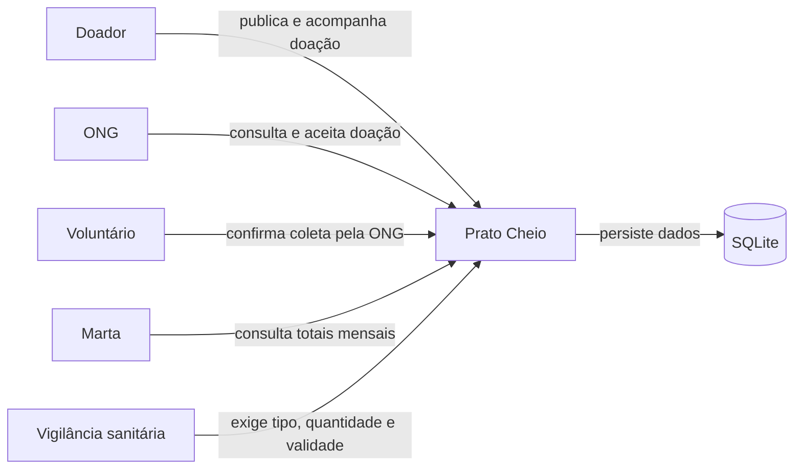

# Diagrama de contexto — Prato Cheio

**Pergunta:** Quem interage com o Prato Cheio e para qual finalidade?

**Decisão que sustenta:** D1 (última milha textual) e D3 (sem serviço externo de mapas).

**Situação:** retrato da proposta do incremento do Trabalho 2; requer merge na `main` para ser retrato da `main`.

**Limitação:** os papéis são representados por identificadores enviados pelo cliente; não há autenticação ou autorização de produção.
