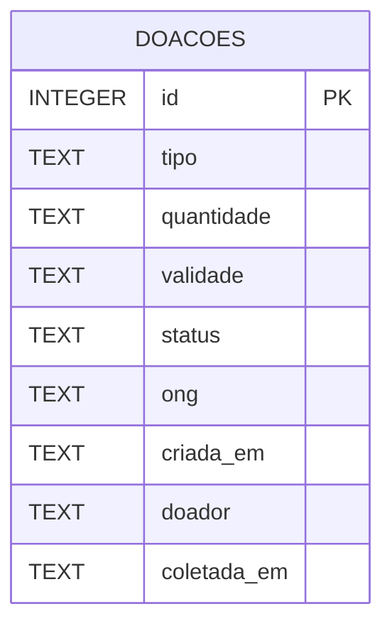

# Diagrama de dados — Prato Cheio

**Pergunta:** Que informação é persistida e como evolui ao longo das histórias?

**Decisão que sustenta:** ADR 0001 (SQLite por ora), ADR 0002 (isolamento de testes) e histórias de coleta/cancelamento.

**Situação:** proposta do incremento do Trabalho 2; corresponde ao schema declarado em `src/db.js` após aplicar `migrar()`.

**Observações:** modelo propositalmente limitado a uma entidade. `doador` e `ong` são textos de identificação do protótipo, não relacionamentos ou identidades autenticadas. `criada_em` usa UTC do SQLite. A migração incremental de colunas preserva bancos antigos.
